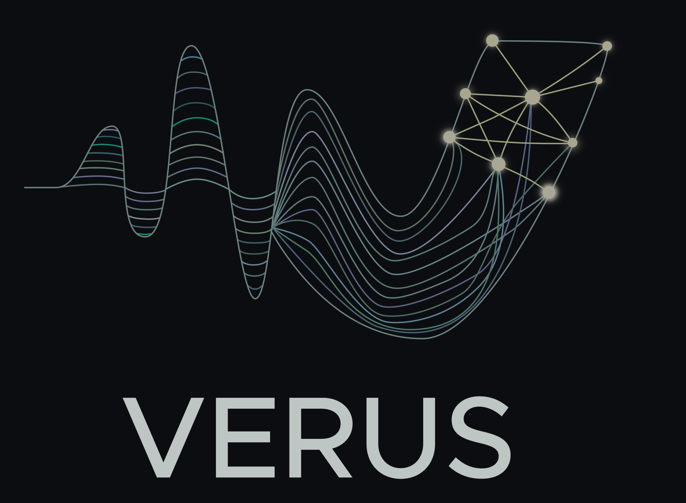

<p align="center">
  
</p>

# Verus

A guitar pedal that turns a pickup signal into the sound of a mic'd acoustic guitar, in stereo. The
input is an acoustic's under-saddle piezo or magnetic soundhole pickup or, the goal of the magnetic
work, an electric guitar's passive magnetic pickup. The output is the pair of microphones you would
record an acoustic with: one in front of the soundhole, one at the shoulder pointing at the 12th fret.
The player picks stereo or mono.

Two neural models, in the [`verus`](src/verus) package:

| Model | Rate | Latency | Purpose |
|---|---|---|---|
| **Offline** (teacher) | 96 kHz | non-causal, ~64 ms look-ahead | quality reference, offline file processing |
| **Realtime** (student) | 48 kHz | causal, 32-sample hops | the pedal: Raspberry Pi + HiFiBerry DAC8x/ADC8x, via TFLite |

The realtime model is distilled from the offline one. The pedal runtime is in
[`runtime/`](runtime/README.md); a desktop app and DAW plugins that can also fine-tune a model to your own
guitar are planned ([ROADMAP.md](docs/ROADMAP.md)).

## Documentation

| | |
|---|---|
| [TRAINING.md](docs/TRAINING.md) | how the system works and how to run every step: data layout, training, export, the Pi |
| [RECORDING.md](docs/RECORDING.md) | how to record the training corpus |
| [runtime/README.md](runtime/README.md) | building and running the pedal runtime |
| [ROADMAP.md](docs/ROADMAP.md) | planned work |
| [CONTRIBUTING.md](CONTRIBUTING.md) | code conventions and running heavy jobs |

## Repository layout

```
src/verus/     the Python package: models, training, export, inference (module map: docs/TRAINING.md §1)
  app/         desktop converter (PySide6)
runtime/       realtime inference + playback engine (C++, TFLite, PortAudio); runs on the pedal
tools/         standalone tools: eq_match.py (electric EQ match), train_guard.py (memory watchdog)
docs/          TRAINING.md, RECORDING.md, ROADMAP.md
out/models/    trained models, written by training (checkpoints, logs and demos go to out/ too; nothing in out/ is tracked)
input/         training audio (not tracked)
assets/        logo
```

## Training data

The corpus is a four-track session: **piezo + magnetic soundhole pickup + soundhole mic + 12th-fret
mic**, recorded simultaneously at 96 kHz / 24-bit, at least 1 h per playing style (pick, finger).

```
input/piezo/<style>/source/takeN_source.wav      piezo, mono
input/magnetic/<style>/source/takeN_source.wav   magnetic, mono
input/piezo/<style>/target/takeN_target.wav      stereo: channel 1 = soundhole mic, channel 2 = 12th-fret mic
input/magnetic/<style>/target/takeN_target.wav   the same file (hard link)
input/finetune/source.wav + target.wav           one pair, for fine-tuning to a user's own guitar
input/eqmatch/                                   EQ-match pair; not read by training
```

- Each take yields two training pairs, piezo → mics and magnetic → mics, that share one mic target.
  This enables a consistency loss between pickups: the same take through either pickup should give
  the same output.
- The mic pair is aligned to the pickups *as a group*; their relative delay is the stereo image and
  is never altered.
- An electric guitar can't have an aligned mic target. It is trained from **fake electric** sources:
  the acoustic's magnetic recordings run through an EQ matched to a real electric DI (`tools/eq_match.py`),
  with the mic recordings as the target and the pickup flag set to magnetic.

How to record it: [RECORDING.md](docs/RECORDING.md). Layout, alignment rules and the legacy layout:
[TRAINING.md](docs/TRAINING.md) §4.

## Model inputs

- **Pickup type**: piezo = 0, magnetic = 1 (`electric` is an alias). Set by the player, never
  classified.
- **Playing style**: pick or finger. Classified by the model; can be forced.
- **Knobs** (realtime model): `outgain`, `phaseinv`, `main`, `pickattack`, `pickreso`, `ir`,
  `drywet`.

## Model outputs

The audio output has two channels: soundhole mic and 12th-fret mic. Training supervises each channel
and also their mid (L+R) and side (L−R) magnitudes, so the stereo image is learned, not only each
mic. For mono, the player gets a blend between the two mics or a delay-aligned sum, which avoids the
comb filtering of summing spaced mics.

The realtime TFLite model has 4 outputs (exactly one is 3-D, so runtimes can pick the audio tensor
by shape when TFLite drops the names):

1. Processed audio, `[1, T, 2]`, `realtime_audio_out`
2. Style probability (pick vs finger, EMA-smoothed by the model), `[1, 1]`, `realtime_style_prob_out`
3. Packed streaming state bundle (lexicographic order of the `realtime_state_*` inputs), `[1, N]`
   float, `realtime_states_bundle_out`
4. Splits (lengths of each state in the bundle), `[1, Nstates]` or `[Nstates]` int32,
   `realtime_states_splits_out`

The offline TFLite model has 2 outputs: audio `[1, T, 2]` and style probability `[1, 1]`.

The master EQ is not part of the models: the pedal applies it post-model (`MasterEqIIR` in
`runtime/src/fx/master_eq.hpp`) and `--process --eq ...` applies the identical biquads in Python.

## Quick start

```
pip install -e .          # installs the `verus` command; TensorFlow (Keras 3), ai-edge-litert, numpy, scipy, soundfile
```

Run everything from the repository root: `input/` and `out/` are resolved relative to the working
directory. Without installing, use `PYTHONPATH=src python -m verus ...`.

Process a file through a trained model. Auto style:

```
verus --process --input in.wav --output out.wav --offline-only
```

Force pick or finger with `--style pick` / `--style finger`. Magnetic pickup source (e.g. an electric
guitar; `electric` is an alias):

```
verus --process --input in.wav --output out.wav --offline-only --pickup magnetic
```

With the pedal's master EQ (low cut 80 Hz @ 24 dB/oct, +2 dB high shelf):

```
verus --process --input in.wav --output out.wav --offline-only --eq lc_hz=80,lc_slope=24,hs_gain_db=2
```

A desktop converter UI:

```
pip install -e ".[app]"
python -m verus.app
```

Training, export and every other command: [TRAINING.md](docs/TRAINING.md) §2.

## Raspberry Pi + HiFiBerry setup

1. Create `/etc/asound.conf`:

   ```
   pcm.!default {
     type hw card 0
   }
   ctl.!default {
     type hw card 0
   }
   ```

2. In `/boot/firmware/config.txt`:

   - Comment out `dtparam=audio=on`
   - Change `dtoverlay=vc4-kms-v3d` to `dtoverlay=vc4-kms-v3d,noaudio`
   - Add:
     ```
     # Hifiberry
     dtoverlay=hifiberry-dac8x
     force_eeprom_read=0
     ```
   - Add this at the end if missing:
     ```
     [all]
     usb_max_current_enable=1
     ```

3. Reboot.

4. Verify with `aplay -l` and `arecord -l`; each should list
   `card 0: sndrpihifiberry [snd_rpi_hifiberry_dac8x]`.

Then build and run the pedal: [runtime/README.md](runtime/README.md).

## License

Copyright (C) 2025–2026 Frederik Wessberg. Licensed under the
[GNU Affero General Public License v3.0](LICENSE) (`AGPL-3.0-only`). The trained models in
`out/models/` (once trained) are released under the same license.
